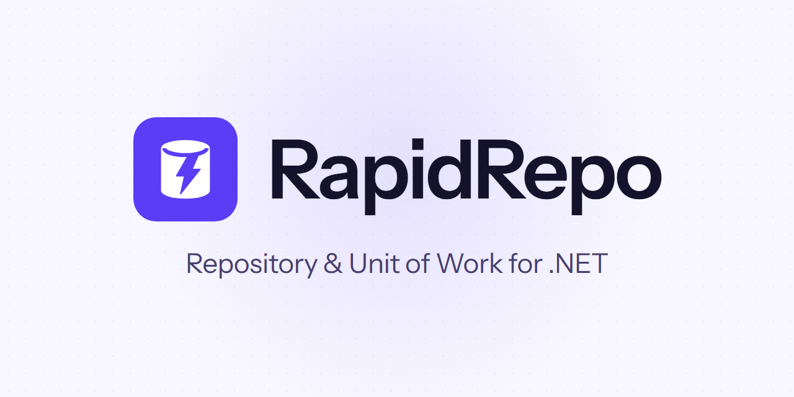

<h1>
  <picture>
    <source media="(prefers-color-scheme: dark)" srcset="assets/social-preview-dark.png">
    
  </picture>
</h1>

[](https://github.com/tibor-horvath/RapidRepo/actions/workflows/dotnet-build.yml)
[](https://github.com/tibor-horvath/RapidRepo/actions/workflows/dotnet-release.yml)
[](https://tiborhorvath.dev)

RapidRepo is a repository and Unit of Work implementation for .NET applications. It gives you a clean, consistent data access layer for common CRUD operations, with auditing, soft delete and paging built in. The contracts are provider-neutral; Entity Framework Core is the provider available today.

## Why RapidRepo?

Most data layers end up rebuilding the same plumbing: setting `CreatedBy` and `ModifiedAt` before every save, a soft-delete flag that every query must remember to filter, paging and sorting helpers, and the DI registrations that wire it all together. RapidRepo provides that plumbing once, with one set of rules:

- **Auditing in one place.** `CommitAsync` stamps the created and modified fields of auditable entities (`IAuditableEntity`, `BaseAuditableEntity`) and the deleted fields of soft-deletable ones with the committing user (or the Unit of Work's default user) and one timestamp per commit. The time comes from a `TimeProvider` that tests can replace. Services don't set these fields by hand, as long as they save through the Unit of Work and not `DbContext.SaveChanges()`.
- **Soft delete you opt into per entity.** For entities that implement `IDeletableEntity` (or derive from `BaseAuditableDeletableEntity`), `Delete` sets `DeletedAt` instead of removing the row. `Restore` and `HardDelete` are explicit operations. Other entities are deleted normally. Reads exclude deleted rows unless you pass `IncludeDeleted`; with EF Core, you turn this on once with `modelBuilder.AddSoftDeleteQueryFilters()`.
- **Your domain can stay free of EF Core.** Entities, repository interfaces and the Unit of Work interface only need the `RapidRepo` contracts package, which has no dependencies. In a layered solution, only the infrastructure project that installs `RapidRepo.EntityFrameworkCore` references EF Core, and the interfaces your services use are easy to mock.
- **A specified contract, not just an implementation.** Write, soft-delete, audit and query semantics are pinned down by a provider-neutral xUnit conformance suite in this repository. The EF Core provider runs it, and a new provider can run it to prove it behaves the same way behind the same interfaces. See [Writing a provider](docs/RapidRepo/providers.md).
- **EF Core is still there for hard queries.** When the contract isn't enough, `EfReadOptions` adds includes, tracking and split queries, `Query()` returns an `IQueryable`, and the `DbContext` is still yours.
- **Little boilerplate.** With `RegisterGenericRepositories = true`, you can inject `IRepository<TEntity, TKey>` without writing a class. `AddRapidRepo` scans assemblies and registers your repositories and Unit of Work. `[GenerateUnitOfWork]` generates the Unit of Work's repository properties and its interface.

### "Isn't `DbContext` already a repository and Unit of Work?"

It is, and RapidRepo builds on it rather than hiding it. What it adds is a smaller, intention-revealing surface; audit and soft-delete rules enforced in one place instead of in every service; and contracts that keep EF Core types out of the layers that don't need them.

**When it may not fit:** small apps where using `DbContext` directly is simpler, or data access that is mostly complex, store-specific queries. Those would live behind `Query()` or the `DbContext` anyway, so the abstraction would add little.

## Features

- Repository and Unit of Work abstractions that do not depend on the persistence technology
- EF Core provider, with includes, tracking, split queries and `IQueryable` when you need them
- Consistent and reusable CRUD patterns
- Supports non-null entity key types (e.g. `int`, `Guid`, `string`)
- Built-in auditing (`CreatedAt`, `CreatedBy`, `ModifiedAt`, `ModifiedBy`), stamped at commit with a controllable clock
- Built-in soft delete (`DeletedAt`, `DeletedBy`) with restore and permanent-delete escape hatches
- Paged query results via `Paged<T>`, with declarative sorting
- Optional companion packages for DI registration and Unit of Work source generation

## Requirements

- .NET 10 or .NET 11
- For the EF Core provider: EF Core 10 or 11

## Packages

| Package | What it contains |
|---|---|
| `RapidRepo` | Entities, repository and Unit of Work contracts, `ReadOptions`, `SortOrder<T>`, audit and soft-delete rules. No dependencies |
| [`RapidRepo.EntityFrameworkCore`](docs/RapidRepo.EntityFrameworkCore/entity-framework-core.md) | The EF Core provider: `EfRepository`, `EfUnitOfWork`, `EfReadOptions`, `AddSoftDeleteQueryFilters()`, `UseEntityFrameworkCore<TContext>()` |
| [`RapidRepo.Extensions.DependencyInjection`](docs/RapidRepo.Extensions.DependencyInjection/dependency-injection.md) | `AddRapidRepo(...)`: scans assemblies and registers repositories and the Unit of Work |
| [`RapidRepo.SourceGenerators`](docs/RapidRepo.SourceGenerators/unit-of-work.md) | `[GenerateUnitOfWork]`: emits repository properties and a companion interface on your `partial` Unit of Work class |

For an EF Core application, one package brings in the core and the DI extension:

```bash
dotnet add package RapidRepo.EntityFrameworkCore
```

The source generator is optional. Reference it as an analyzer:

```xml
<PackageReference Include="RapidRepo.SourceGenerators" Version="..."
    PrivateAssets="all"
    OutputItemType="Analyzer"
    ReferenceOutputAssembly="false" />
```

Upgrading from 8.x? See the [migration guide](docs/migration/8.x-to-9.0.md).

## Quick Start

```csharp
// 1. Define an entity
public class Product : BaseAuditableDeletableEntity<long, Guid>
{
    public string Name { get; set; } = string.Empty;
    public decimal Price { get; set; }
}

// 2. Map it, with soft-deleted rows filtered out by default
public class AppDbContext(DbContextOptions<AppDbContext> options) : DbContext(options)
{
    public DbSet<Product> Products => Set<Product>();

    protected override void OnModelCreating(ModelBuilder modelBuilder)
        => modelBuilder.AddSoftDeleteQueryFilters();
}

// 3a. Zero-boilerplate: inject the root interface directly (no custom class needed)
public class CatalogService(IRepository<Product, long> products) { ... }

// 3b. Custom repository: only needed for methods beyond standard CRUD
public interface IProductRepository : IRepository<Product, long>
{
    Task<IEnumerable<Product>> GetCheapestAsync(int count);
}

public class ProductRepository(AppDbContext context) : EfRepository<Product, long>(context), IProductRepository
{
    public async Task<IEnumerable<Product>> GetCheapestAsync(int count)
        => (await GetAllPagedAsync(orderBy: SortOrder<Product>.By(p => p.Price), pageSize: count)).Results;
}

// 4. Create a Unit of Work
public interface IAppUnitOfWork : IUnitOfWork<Guid>
{
    IProductRepository Products { get; }
}

public class AppUnitOfWork(AppDbContext dbContext, IProductRepository products)
    : EfUnitOfWork<Guid>(dbContext, Guid.Empty), IAppUnitOfWork
{
    public IProductRepository Products { get; } = products;
}

// 5. Register in DI (Program.cs)
builder.Services.AddDbContext<AppDbContext>(options =>
    options.UseSqlServer(builder.Configuration.GetConnectionString("Default")));

builder.Services.AddRapidRepo(options =>
{
    options.UseEntityFrameworkCore<AppDbContext>();
    options.ScanAssembliesContaining<ProductRepository>();
    options.RegisterGenericRepositories = true;   // allows IRepository<Product, long> injection
    options.UseUnitOfWork<AppUnitOfWork>();        // interface auto-detected
});

// 6. Use in a service
public class ProductService(IAppUnitOfWork unitOfWork)
{
    public Task<IEnumerable<Product>> GetActiveAsync()
        => unitOfWork.Products.GetAllAsync(p => p.Price > 0, SortOrder<Product>.By(p => p.Name));

    public async Task CreateAsync(Product product, Guid currentUser)
    {
        await unitOfWork.Products.AddAsync(product);
        await unitOfWork.CommitAsync(currentUser);
    }
}
```

## Documentation

| Package | Topic | Description |
|---|---|---|
| RapidRepo | [Entities](docs/RapidRepo/entities.md) | `BaseEntity`, `BaseAuditableEntity`, `BaseAuditableDeletableEntity`, soft delete |
| RapidRepo | [Repositories](docs/RapidRepo/repositories.md) | Interfaces, write semantics, soft delete and restore, custom methods |
| RapidRepo | [Unit of Work](docs/RapidRepo/unit-of-work.md) | Setup, committing, auditing |
| RapidRepo | [API Reference](docs/RapidRepo/api-reference.md) | Read and write methods, `ReadOptions`, `SortOrder<T>` |
| RapidRepo | [Advanced Usage](docs/RapidRepo/advanced.md) | Filtering, sorting, projection, paging, bulk operations |
| RapidRepo | [Writing a provider](docs/RapidRepo/providers.md) | Base classes, the DI hook, and the conformance suite |
| RapidRepo.EntityFrameworkCore | [EF Core](docs/RapidRepo.EntityFrameworkCore/entity-framework-core.md) | `EfRepository`, `EfUnitOfWork`, `EfReadOptions`, custom queries, soft-delete filters |
| RapidRepo.EntityFrameworkCore | [EF Core and DI](docs/RapidRepo.EntityFrameworkCore/dependency-injection.md) | `UseEntityFrameworkCore`, generic repositories per `DbSet`, multiple contexts |
| RapidRepo.Extensions.DependencyInjection | [Dependency Injection](docs/RapidRepo.Extensions.DependencyInjection/dependency-injection.md) | `AddRapidRepo`, scanning options, filters, lifetime, providers |
| RapidRepo.SourceGenerators | [Unit of Work](docs/RapidRepo.SourceGenerators/unit-of-work.md) | `[GenerateUnitOfWork]` source generator |
| — | [Migrating from 8.x to 9.0](docs/migration/8.x-to-9.0.md) | Package split, renamed types, read options, behaviour changes |

## License

RapidRepo is licensed under the MIT License. See [LICENSE](./LICENSE) for details.
